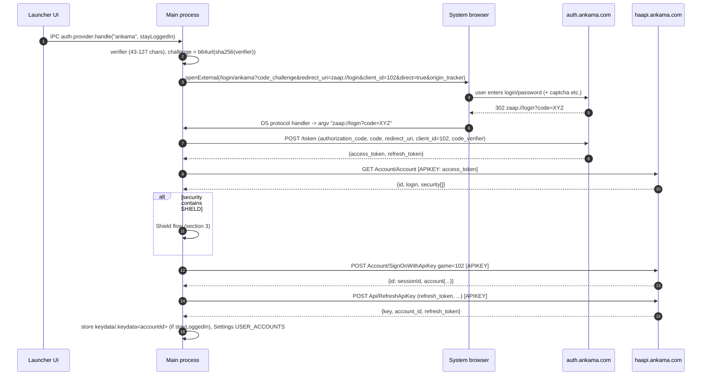
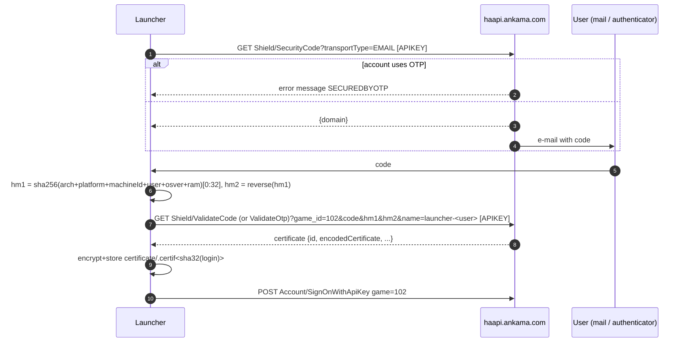
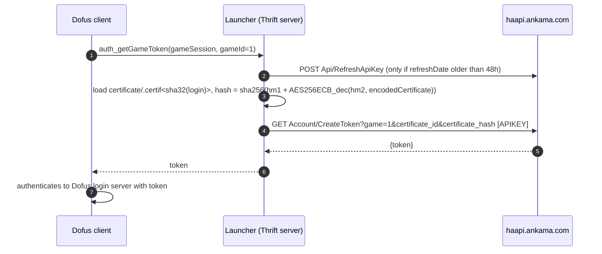

# 01 - Authentication & account management (Haapi / auth.ankama.com / Shield)

Source: Ankama Launcher ("Zaap") 3.15.5, static analysis only.
All `L####` references are line numbers in `re/pretty/main.js` unless prefixed `renderer:`.
No real credential, token or user file was read, decrypted or sent while producing this document.

Legend used throughout:

- **[OBS]** observed directly in code.
- **[DER]** derived mechanically from observed code (e.g. library default behaviour of a bundled lib).
- **[INF]** inference (plausible, not proven by the code).
- **[UNK]** unknown / needs a live capture to confirm.

---

## 0. Constants

| Name | Value | Where |
|---|---|---|
| Haapi base URL | `https://haapi.ankama.com/` | L72298 (`buildConfig.app.haapiUrl`) |
| Auth (OAuth) base URL | `https://auth.ankama.com/` | L72302 (`buildConfig.app.authUrl`) |
| Haapi path prefix | `json/Ankama/v5/` | L3257-3343 |
| `ZAAP_GAME_ID` (launcher "game" id, also OAuth `client_id`) | `102` | L787 |
| `SHOP_HAAPI_KEYS` | `shop_key=ZAAP`, `payment_mode=OK` | L938 |
| Dofus game id | `1` (`GAMES_NAME = {1:"Dofus",3:"Wakfu",17:"Krosmaga",22:"Waven"}`) | L980-985; `ACCOUNT_DETAILS_OPTIONS.ABODOFUS.gameId=1` L965 |
| App name / userData folder | `zaap` -> `%APPDATA%\zaap` | L72291, L1612-1616 |
| Custom URL scheme | `zaap://` (`buildConfig.name`) | L62903, L38650 |
| HTTP User-Agent | `Zaap <app version>` = `Zaap 3.15.5` | L12218, package.json `version` |
| Haapi retry policy | promise-retry, `minTimeout 5000, maxTimeout 20000, retries 3, randomize` - **only on request timeouts** | L894-899, L3347-3412 |
| HTTP timeout | 5000 ms when `domain==="com"` (production), else 10000 | L12213 |

---

## 1. HTTP transport details (shared by all Haapi calls)

Module at L12198-12260 (`http`), using bundled `electron-fetch`.

- **[OBS]** Every request: header `User-Agent: Zaap <version>` (L12217-12219).
- **[OBS]** Auth header: `APIKEY: <apiKey.key>` (custom header, not `Authorization`). Passed per call, e.g. L113149.
- **[OBS]** GET: query string built with Node `querystring.stringify(params)` (L3344-3345, module `n(297)`, `require("querystring")` L45136 [INF: id match]). GET also sets header `If-None-Match: null` (L12234-12238) - [DER] electron-fetch stringifies it, so the literal header value `null` is likely sent; harmless to omit.
- **[DER]** Node `querystring.stringify` renders `undefined` as empty: e.g. `CreateToken` without certificate sends `game=1&certificate_id=&certificate_hash=`. [INF] Omitting the empty params should be equivalent.
- **[OBS]** POST: body = `querystring.stringify(body)` (form-urlencoded string) unless header `Content-Type: application/json` is passed explicitly (never the case for the auth calls) (L12240-12249).
- **[DER]** No Content-Type is set by Zaap, so electron-fetch adds `Content-Type: text/plain;charset=UTF-8` for a string body (L81244-81259). Body is still `a=b&c=d`. A re-implementation should send the same form body; `application/x-www-form-urlencoded` is the conventional choice [INF: accepted by Haapi; to verify].
- **[OBS]** electron-fetch also sets `Accept-Encoding: gzip,deflate`, `Connection: close` (L81329-81330).
- **[OBS]** Status >= 400 -> throws `HttpError{statusCode, body}`; body JSON-parsed when `content-type === "application/json"` (L12224-12230).
- **[OBS]** Success bodies with `application/json` are parsed with **json-bigint** (default options; numbers > 2^53 become BigNumber) (L12231-12233, dep L33702). Use a big-int-safe parser (account ids, session ids).
- **[OBS]** Error mapping (L3360-3410): `body.reason==="ANONYMOUS_IP_FORBIDDEN"` -> VPN/proxy refusal; network codes `ENOTFOUND/ERR_INTERNET_DISCONNECTED/ERR_NETWORK_CHANGED/ECONNRESET` -> `haapi.notReachable` (1000); **HTTP 429 -> "Ban HAAPI" / `BANCLOUDFLARE`** (rate-limited by Cloudflare). Only timeouts are retried.
- Haapi error vocabulary (`body.reason` / `body.message`): `BAN, BLACKLIST, LOCKED, DELETED, RESETANKAMA, OTPTIMEFAILED, SECURITYCARD, BRUTEFORCE, FAILED, PARTNER, MAILNOVALID, BETACLOSED, NOACCOUNT, ACCOUNT_LINKED, ACCOUNT_INVALID, ACCOUNT_SHIELDED, ACCOUNT_NO_CERTIFY, ANONYMOUS_IP_FORBIDDEN, CODEBADCODE, CODEEXPIRE, CODENOTFOUND, CODEPROBLEM, ALREADYSECURED` (L72470-72540).

---

## 2. Login flows

There are **three** ways an API key is obtained. In 3.15.5 the **interactive login UI only uses OAuth2 + PKCE via the system browser**; the password-based `Api/CreateApiKey` path is only reached for stored *guest* accounts.

### 2.1 Primary: OAuth2 Authorization Code + PKCE (system browser)  [OBS]

Code: `Provider` class L38559-38755; deep link handler L62882-62950; renderer button `handleProvider("ankama")` renderer:32580, social providers `facebook|google|steam|apple` renderer:80778-80784.

1. Renderer sends IPC `auth.provider.handle (provider, isStayLoggedIn)` (L38596-38598).
2. `generateCodeVerifier()` (L38600-38607): length `floor(85*Math.random()+43)` (43..127) chars, from `A-Za-z0-9-._~`, using `Math.random()` (not a CSPRNG - use a CSPRNG in a re-implementation).
3. `code_challenge = base64url(sha256(verifier))` without padding (`createCodeChallenge`, L25471-25480). Method is S256 [INF: `code_challenge_method` is **not** sent; server must default to S256].
4. Redirect URI (`getRedirectUri`, L38649-38657): packaged build on Windows/macOS -> `zaap://login`; on Linux or non-packaged builds -> `http://127.0.0.1:9001/authorized` (a local HTTP server on port 9001 is started, L38609-38647).
5. Browser opened with `shell.openExternal` (L38658-38683):

   ```
   GET https://auth.ankama.com/{mode}/{provider}?code_challenge=<c>&redirect_uri=<uri>&client_id=102&direct=true&origin_tracker=https://www.ankama-launcher.com/<source|launcher>[&extra...]
   ```
   - `mode` default `login`; guest validation uses `register-direct` (L2926).
   - `provider` = `ankama` (login/password page), or `facebook|google|steam|apple`, or `ankama-guest` (with extra `token=` param, L2892).
   - **[OBS] Params are joined raw (`${k}=${v}`), not URL-encoded** (L38677-38680). `redirect_uri` therefore appears un-encoded (`zaap://login`). A re-implementation should URL-encode values [INF: server accepts both].
6. Browser eventually navigates to `zaap://login?code=<code>`. Windows passes the URL as argv to a 2nd instance -> `second-instance` / `open-url` -> `requestFromScheme` extracts `code` (L62906-62947). Local-server variant reads `?code=` from the request (L38617-38620). **No `state` parameter is used or checked.**
7. Token exchange (`getAccessTokenWithCode`, L38684-38720), axios:

   ```
   POST https://auth.ankama.com/token
   Content-Type: application/x-www-form-urlencoded
   User-Agent: Zaap 3.15.5
   grant_type=authorization_code&code=<code>&redirect_uri=<same uri>&client_id=102&code_verifier=<verifier>
   ```
   Response fields consumed: `access_token`, `refresh_token`, optional `guest_credentials{login,password}` (L38721-38737).
8. The OAuth **`access_token` is used directly as the Haapi `APIKEY`** (`apiKey = {key: access_token, provider, refreshToken: refresh_token, isStayLoggedIn}`, L38721-38726).
9. `GET Account/Account` with that APIKEY -> `{id, login, security, ...}` (L38738-38740). Sets `apiKey.accountId = id`, `apiKey.login = login`. Refuses duplicates (`auth.accountAlreadyRegistered`, L38741-38746).
10. If `account.security` contains `"SHIELD"` -> Shield flow (section 3) (L38747); otherwise `addAccount` (SignOnWithApiKey, section 2.4) then `refreshApiKey` (L38748-38749).

### 2.2 Password login: `Api/CreateApiKey`  [OBS] (used only by `guestConnect`, L2851-2870)

`Auth.login(login, password)` L2346-2356 -> `AuthHelper.generateApiForAccount` L64906-64937 -> handler L114034-114068.

```
POST https://haapi.ankama.com/json/Ankama/v5/Api/CreateApiKey
login=<login>&password=<password>&game_id=102&long_life_token=true&shop_key=ZAAP&payment_mode=OK&lang=<fr|en|...>&certificate_id=<id?>&certificate_hash=<hash?>
```
- `certificate_id`/`certificate_hash` only present when a stored certificate exists for that login (section 4); otherwise sent empty [DER].
- Response consumed: `key`, `account_id`, `refresh_token`, `data.security_state`, `data.security_detail` -> `{key, accountId, refreshToken, security, reason}`.
- [DER] booleans are serialized by querystring as `true`/`false`.
- If `security` includes `"UNSECURED"` -> Shield flow; else `addAccount` (L2352-2355).
- 403 is reported to Sentry as "Ban HAAPI" (L114061).
- [INF] This endpoint is the one historically used by 3rd-party launchers; Ankama now funnels interactive logins through auth.ankama.com, and may add captcha/Cloudflare protection on this endpoint. Treat as fallback.

### 2.3 Guest accounts (not needed for Dofus-only launcher)

- `POST {authUrl}token/create-guest` body `client_id=102` -> `{token}` -> OAuth `ankama-guest` provider with `token` (L2874-2895).
- `POST {authUrl}token/validate-guest` body `client_id=102&account_id=<id>`, `Authorization: Basic base64(login:password)` -> `{token}` -> OAuth `register-direct/ankama` (L2897-2927).
- Guest credentials stored encrypted in `guest/.guest<sha32(login)>` (L65004-65015).
- Unused handlers kept in bundle: `Api/CreateApiKeyFromToken` (L113999-114031), `Account/ValidateGuestCodeApiKey` (L113967-113997), `Provider/ApiKeyLogin` (L114430-114452), `Provider/ApiKeyGhostCreate` (L114405-114428) - registered (L3179-3202) but **no call site** in main/renderer.

### 2.4 Session establishment: `Account/SignOnWithApiKey`  [OBS]

`addAccount` L2357-2391 -> `signOnWithApiKey` L2435-2470 -> handler L113933-113950.

```
POST https://haapi.ankama.com/json/Ankama/v5/Account/SignOnWithApiKey
APIKEY: <key>
game=102
```
Response: `{ id: <account session id>, account: {id, type, login, nickname, firstname, lastname, tag, security, added_date, locked, parent_email_status, avatar_url, ...} }`.
- `account.locked === "2"` (MAILNOVALID) -> e-mail not confirmed, login aborted (L113944-113947, L979).
- `id` (session id) is only used for KPI telemetry (`Kpi.registerUserAndStartKpi`, L8236-8250).
- Account normalized by `parseAccount` (L114681-114713) -> stored in Settings `USER_ACCOUNTS` (section 6).
- Then (first account only): `Account/Status`, `Game/ListWithApiKey`, KPI start (L2392-2425).

### Sequence - OAuth login (Ankama provider)



---

## 3. Shield (2FA / new device) and certificates  [OBS]

### 3.1 Trigger

- OAuth path: `Account/Account.security` includes `"SHIELD"` (L38747).
- Password path: `CreateApiKey.data.security_state` includes `"UNSECURED"` (L2352).

### 3.2 Request a code: `Shield/SecurityCode`

`askForDoubleAuth` L2310-2338, handler L114453-114460.

```
GET https://haapi.ankama.com/json/Ankama/v5/Shield/SecurityCode?transportType=EMAIL   (or SMS when resend asks for it)
APIKEY: <key>
```
- Response: `{domain: "<masked e-mail domain>"}` -> UI route `/login/doubleauth/:accountId/:domain` (renderer:231156).
- Error `body.message === "SECUREDBYOTP"` -> account uses an authenticator app: UI route `...?otp=true` (L2326-2327, renderer:231159). `NONEEDTOBESECURED` -> nothing to do (L2330).
- `RESEND_CODE` IPC re-calls this with the SMS flag (L2244-2247).
- The pending key is kept in memory in `temporaryApiKey[accountId]` until validated (L2333, L2829-2837).

### 3.3 Validate: `Shield/ValidateCode` / `Shield/ValidateOtp`

`askCertificateForApiKey` L64974-64987; handlers L114462-114490 (code) and L114492-114524 (OTP).

```
GET https://haapi.ankama.com/json/Ankama/v5/Shield/ValidateCode?game_id=102&code=<code>&hm1=<hm1>&hm2=<hm2>&name=launcher-<os username>
GET https://haapi.ankama.com/json/Ankama/v5/Shield/ValidateOtp ?game_id=102&code=<otp>&hm1=<hm1>&hm2=<hm2>&name=launcher-<os username>
APIKEY: <key>
```
- `name` = `"launcher-" + os.userInfo().username` (device label shown in Ankama account security page) (L114470).
- Response body = **certificate object**, stored as-is plus `login` (L64981-64986). Fields consumed: `id` (certificate id) and `encodedCertificate` (base64) (L25459-25470, L2767). [UNK] other fields.
- Error `403 + "ALREADYSECURED"` -> account logged out (L114484-114488).
- After success: `addAccount` (SignOnWithApiKey) and, for OAuth keys, `refreshApiKey` (L2213-2233). **The API key itself is not recreated** - the certificate is only used later by `CreateToken` (and by `CreateApiKey` for password logins).

### 3.4 hm1 / hm2 machine fingerprint  (`createHmEncoders`, L64989-65003)  [OBS]

```
parts = [ os.arch(),                      // "x64"
          os.platform(),                  // "win32"
          machineId(),                    // node-machine-id, hashed form (see below); omitted if it throws
          os.userInfo().username,
          getOsVersion(),                 // L30626-30630
          getComputerRam() ]              // L30619-30625
hm1 = sha256_hex(parts.join(""))[0:32]    // createHashFromStringSha L25390-25395 (first 32 hex chars)
hm2 = reverse(hm1)                        // character-reversed string
```
- `machineId()` (node-machine-id 1.1.12, L17555-17625): Windows runs `%windir%\System32\REG.exe QUERY HKLM\SOFTWARE\Microsoft\Cryptography /v MachineGuid` (sysnative variant for 32-bit process on 64-bit OS), takes text after `REG_SZ`, strips all whitespace, lowercases, then returns **`sha256_hex(guid)`** (64 hex chars) because it is called without `original=true`. macOS: `IOPlatformUUID`; Linux: `/var/lib/dbus/machine-id` or `/etc/machine-id`.
- `getOsVersion()` = `parseFloat(major + "." + minor)` of `os.release()`; Windows 10/11 `10.0.x` -> `10` -> string `"10"`. (JS number-to-string: `10.0` becomes `"10"`; `6.1` stays `"6.1"`.)
- `getComputerRam()` = `2 ** round(log2(os.totalmem() / 1024 / 1024))` (MiB rounded to power of two; e.g. 16 GiB -> `16384`).
- Join separator is the empty string. Order is arch **then** platform (differs from the storage UUID below).

### 3.5 Certificate hash  (`generateHashFromCertif`, L25459-25470)  [OBS]

```
plain = AES-256-ECB-decrypt( key = utf8(hm2) /* 32 ASCII bytes */, iv = none,
                             data = base64decode(certificate.encodedCertificate), PKCS#7 padding )
certificate_hash = sha256_hex( hm1 + plain.toString("utf8") )     // 64 hex chars
certificate_id   = certificate.id
```
Consequence: a certificate is bound to the machine fingerprint; a re-implementation must compute hm1/hm2 **identically** to reuse a certificate created by the official launcher. If decryption fails the launcher deletes the certificate file (L2768-2781, L64913-64925).



---

## 4. API key lifecycle

### 4.1 In-memory object (`apiKey`) [OBS]

`{ key, accountId, refreshToken, provider?, isStayLoggedIn, login, refreshDate?, certificate?, security?, reason? }`
(L38721-38726, L114050-114056, L2350-2351, L2708-2710, L2215).

### 4.2 Refresh: `Api/RefreshApiKey`  (`Auth.refreshApiKey` L2693-2727, handler L114074-114100)

```
POST https://haapi.ankama.com/json/Ankama/v5/Api/RefreshApiKey
APIKEY: <key>
refresh_token=<refreshToken>&long_life_token=true&shop_key=ZAAP&payment_mode=OK&lang=<lang>
```
- Response: `{key, account_id, refresh_token}`. **[OBS] Zaap only persists the new `refresh_token` and sets `refreshDate = now`; the returned `key` is ignored** (L2702-2710). [INF] key is unchanged by refresh; a re-implementation should still update `key` if it differs.
- Throttle: skipped if `refreshDate + 172800000 ms (48 h) > now` (L2700).
- Called: after OAuth login (L38749), on startup for the main account (L2668-2670), on startup for secondary accounts only if `refreshDate + 1296000000 ms (15 days) < now` (L2672-2675), on account switch (`reconnectAccount`, L2615-2640), and before each `CreateToken` (L2760).
- [UNK] Server-side lifetime of a long-life key/refresh token (not encoded in client). The 15-day rule suggests a refresh-token lifetime on the order of weeks.

### 4.3 Revocation: `Api/DeleteApiKey`  (L114069-114073, `removeApiKey` L2565-2579)

```
GET https://haapi.ankama.com/json/Ankama/v5/Api/DeleteApiKey
APIKEY: <key>
```
Then deletes `keydata/.keydata<accountId>`. Failures are logged and local cleanup still happens.

### 4.4 Logout semantics [OBS]

- `logout()` (all) L2471-2503: KPI end, DeleteApiKey for every key, delete `USER_ACCOUNTS`, delete all keydata files, clear `VOD_ACCESS_TOKEN`. IPC `auth.logout` also deletes every account's certificate first (L2186-2207).
- `logoutAccount(k)` L2504-2519: if it was the main account and another exists, `setMainUser(other)` then remove; else full logout.
- `removeAccount(id)` L2520-2564: deletes certificate, removes from `USER_ACCOUNTS`, DeleteApiKey.
- Forced logouts: HTTP 401 on `CreateToken` (L2787-2790); `ALREADYSECURED` on Shield validate; startup failure of SignOn other than "not reachable" (L2678-2690).
- On quit (`cleanBeforeQuit` L2580-2614): accounts with `isStayLoggedIn=false` get certificate deleted + logout; accounts with `nickname===null` (non-main) are removed.

### 4.5 Startup restore (`authenticateFromStoredApiKey` L2642-2663, `processStoredApiKey` L2664-2692)

Read all `keydata/*` files, decrypt, default `isStayLoggedIn=true`; require one matching the Settings main account (`isMain`), process main first: SignOnWithApiKey -> commonProcess -> RefreshApiKey; others: commonProcess (+refresh if > 15 days). Offline (error code 1000) -> wait for `online` event and retry.

---

## 5. Game token: `Account/CreateToken`  [OBS]

`Auth.createToken(gameId, accountId)` L2742-2800, handler L113136-113158.

```
GET https://haapi.ankama.com/json/Ankama/v5/Account/CreateToken?game=<gameId>&certificate_id=<id>&certificate_hash=<hash>
APIKEY: <key>
```
- Response consumed: `body.token` (one-time game login token string).
- Steps: `refreshApiKey(h)` (48 h throttle) -> load certificate by `login` -> if present compute `certificate_hash` (section 3.5) -> call. Without certificate the two params are empty/omitted.
- Errors: 401 -> logout of that account; 403 -> account flagged `isErrored`, UI "expired session" popup (L2786-2798).
- **Who asks for it:** the running game, over Zaap's local Thrift RPC `ZaapService.auth_getGameToken(gameSession, gameId)` (handler L65555-65572) or `auth_getGameTokenWithWindowId(..., gameId, windowId)` for multi-account (L65574-65618, uses `getNthAccountId(windowId)` over `active` accounts L2801-2806). The **gameId comes from the game**; for Dofus it is `1` [INF: from `GAMES_NAME`/`ABODOFUS`; confirm in the launch/thrift spec]. The account used is the one bound to the game session (`service.getAccountId`). (Thrift transport and launch arguments are out of scope here; see the game-launch spec.)
- Renderer can also request one via IPC `auth.createToken {gameId, accountId}` (L2248-2256) - no certificate in that path.



---

## 6. Local persistence (`%APPDATA%\zaap`)  [OBS]

`userData = path.join(app.getPath("appData"), "zaap")` (L1612-1616). On Windows: `C:\Users\<u>\AppData\Roaming\zaap`.

| Path | Content | Format | Code |
|---|---|---|---|
| `Settings` (no extension) | All settings incl. `USER_ACCOUNTS`, `DEVICE_UID`, `LANGUAGE`, `ACCEPTED_TERMS_VERSION`, `_schemaVersion: 2` | **plain JSON** (electron-settings 3.2.0 via jsonfile; keys are the literal enum names) | L1617, L43518-43568, key enum L1137-1190, defaults L620-675 |
| `keydata/.keydata<accountId>` | serialized `apiKey` object (section 4.1, may embed `certificate`) | encrypted (6.1) | L64825-64834 |
| `certificate/.certif<H(login)>` | Shield certificate object + `login` | encrypted (6.1) | L64949-64963 |
| `guest/.guest<H(login)>` | `{login, password}` for guest accounts | encrypted (6.1) | L65004-65015 |

`H(x) = sha256_hex(x)[0:32]` (`createHashFromStringSha`, L25390-25395). `login` is the Ankama login (usually an e-mail) exactly as returned by `Account/Account`.

### 6.1 File encryption (`cryptoHelper`, L25365-25458)

```
uuid   = [os.platform(), os.arch(), machineId(), os.cpus().length, os.cpus()[0].model].join(",")
         // machineId(): sha256 hex of MachineGuid (see 3.4); if it throws, the literal "#" is used
         // e.g. "win32,x64,<64 hex>,16,AMD Ryzen 7 5800X 8-Core Processor" (cpu model string verbatim, incl. spaces)
key    = MD5(utf8(uuid))                                  // 16 raw bytes -> AES-128
iv     = 16 random bytes
ct     = AES-128-CBC(key, iv, PKCS#7, utf8(JSON.stringify(obj)))
file   = hex(iv) + "|" + hex(ct)                          // lowercase hex, written as utf8 text, no newline
decrypt: split on "|", hex-decode both, AES-128-CBC-decrypt, JSON.parse
```
Notes:
- Separator `","` (Array.join default) here, vs `""` for hm1. Order platform,arch here vs arch,platform for hm1.
- The cpu model string is whatever Node `os.cpus()[0].model` returns (on Windows it comes from the registry `ProcessorNameString`, may contain trailing spaces) - a re-implementation in another language must reproduce it byte-for-byte to read existing files [INF].
- No MAC/authentication; undecryptable certificate files are deleted (L64893-64902).
- Recommendation for a replacement launcher: read official files for migration only; store your own data in your own folder to avoid fighting the official launcher.

### 6.2 `USER_ACCOUNTS` entry (Settings)

Merged by `User.setInfo` (L11629-11646) from: `parseAccount` (`id, type, login, nickname, firstname, lastname, nicknameWithTag="<nick>#<tag>", tag, security, addedDate, locked, parentEmailStatus, avatar, isGuest`) + launcher flags `isMain, active, isErrored, needRefresh, note` + `Account/Status` (`acceptedTermsVersion`, `all`) + `gameList` (from `Game/ListWithApiKey`). First account inserted becomes `isMain`; new accounts get `active=true`. No secret is stored in Settings.

`DEVICE_UID` = random UUIDv4 created once (L61515-61527), only used for telemetry.

---

## 7. Multi-account, switching, profile

- Multiple keys held in `Auth.apiKeys[]`, one per `accountId` (L2426-2434). Main account = `USER_ACCOUNTS[].isMain` (L743-745); `getMainApiKey()` L2729-2738.
- Switch main: IPC `set.main.user` -> `User.setMainUser` (L11445-11474): `reconnectAccount` (SignOn + RefreshApiKey + game list + status), flip `isMain`, refresh VOD/Tower tokens, re-init chat.
- Per-window multi-account for games: `auth_getGameTokenWithWindowId(windowId)` -> Nth `active` account; allowed only if release `information.default.multiAccount` (L65589-65597).
- Profile: there is **no separate "Account/Profile" call**; profile comes from `Account/Account` (OAuth only) and `SignOnWithApiKey.account`. Nickname: `POST Account/SetNicknameWithApiKey nickname=&lang=` (L113922-113931) - accounts without nickname are prompted (route `nickname/:accountId`).
- `GET Account/Status` (L113958-113966): array `[{id, value}]` -> map; `CGU` = accepted ToU version; `DATA_COLLECT` etc. Used to gate releases (`needName`, `askDataCollect`, `teasing`) (L34843-34900, L35489-35492).
- `GET Game/ListWithApiKey` (L114192-114229): `[{game_id, expiration_date, total_time_elapsed}]` -> subscription state (Dofus = game 1, "not free to play").

---

## 8. Endpoint table

Base `https://haapi.ankama.com/json/Ankama/v5/` unless noted. "Req" = required for a Dofus-only launcher: **Y** required, **O** optional/useful, **N** not needed. Operation key = Zaap's internal name (`Haapi.get(key)` registry L3161-3216), cross-checked with `re/rea-endpoints.txt`.

| Op key | Method / path | Params (query or form body) | Headers | Response used | Line | Req |
|---|---|---|---|---|---|---|
| (OAuth authorize) | GET `https://auth.ankama.com/login/{provider}` (browser) | `code_challenge, redirect_uri, client_id=102, direct=true, origin_tracker` | - | redirect with `code` | L38658 | Y |
| (OAuth token) | POST `https://auth.ankama.com/token` | `grant_type=authorization_code, code, redirect_uri, client_id=102, code_verifier` (urlencoded) | UA | `access_token, refresh_token, guest_credentials?` | L38684 | Y |
| (guest) | POST `auth.ankama.com/token/create-guest`, `/token/validate-guest` | `client_id=102[, account_id]`, Basic auth | | `token` | L2874, L2897 | N |
| ankama.account.getAccount | GET `Account/Account` | - | APIKEY | `id, login, security[]` | L113160 | Y (OAuth) |
| ankama.api.createApiKey | POST `Api/CreateApiKey` | `login, password, game_id=102, long_life_token=true, shop_key=ZAAP, payment_mode=OK, lang, certificate_id?, certificate_hash?` | - | `key, account_id, refresh_token, data.security_state, data.security_detail` | L114034 | O (fallback) |
| ankama.api.refreshApiKey | POST `Api/RefreshApiKey` | `refresh_token, long_life_token=true, shop_key=ZAAP, payment_mode=OK, lang` | APIKEY | `key, account_id, refresh_token` | L114074 | Y |
| ankama.api.deleteApiKey | GET `Api/DeleteApiKey` | - | APIKEY | (2xx) | L114069 | O (logout) |
| ankama.account.signOnWithApiKey | POST `Account/SignOnWithApiKey` | `game=102` | APIKEY | `id, account{...}` | L113933 | O [INF: the launcher always calls it; server may require it before CreateToken - UNK] |
| ankama.shield.securityCode | GET `Shield/SecurityCode` | `transportType=EMAIL\|SMS` | APIKEY | `domain`; err `SECUREDBYOTP` | L114453 | Y |
| ankama.shield.validateCode | GET `Shield/ValidateCode` | `game_id=102, code, hm1, hm2, name=launcher-<user>` | APIKEY | certificate `{id, encodedCertificate,...}` | L114462 | Y |
| ankama.shield.validateOtp | GET `Shield/ValidateOtp` | same as above, OTP code | APIKEY | certificate | L114492 | Y (authenticator users) |
| ankama.account.createToken | GET `Account/CreateToken` | `game=1, certificate_id, certificate_hash` | APIKEY | `token` | L113136 | **Y** |
| ankama.account.status | GET `Account/Status` | - | APIKEY | `[{id,value}]` (`CGU`, `DATA_COLLECT`...) | L113958 | O |
| ankama.game.listWithApiKey | GET `Game/ListWithApiKey` | - | APIKEY | `[{game_id, expiration_date, total_time_elapsed}]` | L114192 | O (show sub) |
| ankama.account.setNicknameWithApiKey | POST `Account/SetNicknameWithApiKey` | `nickname, lang` | APIKEY | account | L113922 | O (new accounts) |
| ankama.account.setIdentityWithApiKey | POST `Account/SetIdentityWithApiKey` | `firstname, lastname` | APIKEY | 204 | L113951 | N (unless release `needName`) |
| ankama.account.dataCollect.set | POST `Account/GDPR/SetConsentApiKey` | `choice` | APIKEY | - | L113881 | N |
| ankama.legal.terms / setTouVersion | GET `Legals/Tou`, POST `Legals/SetTouVersion` | lang/version | APIKEY | ToU | L114328-114360 | O (ToU acceptance) [UNK if required] |
| ankama.account.setEmail / sendMailValidation | POST `Account/SetEmail` / GET `Account/SendMailValidation` | `email` | APIKEY | - | L113908-113920 | N |
| ankama.account.getAccessTokenFromAnkamaApiKey | GET `Account/GetAccessTokenFromAnkamaApiKey` | - | APIKEY | JWT `token` (game-services, cloud save `https://game-service.ankama.com/`) | L113168, L128627 | N |
| ankama.shop.getAccessTokenFromAnkamaApiKey | GET `Shop/GetAccessTokenFromAnkamaApiKey` | - | APIKEY | JWT | L114561 | N |
| ankama.launcher.getAccessToken | GET `Launcher/AccessToken/GetAccessToken` | - | APIKEY | `token` (beta-inscription vote) | L114580, L136338 | N |
| ankama.tower.getAccessToken / ankama.video.getToken | GET `Tower/...`, `Vod/AccessToken/GetAccessToken` | - | APIKEY | token | L114569, L114646 | N |
| ankama.game.startSessionWithApiKey | GET `Game/StartSessionWithApiKey` | `session_id=<SignOn id>, server_id, character_id, date` (null) | APIKEY | session id (bigint) | L114236, L8338 | N (telemetry) |
| ankama.game.endSessionWithApiKey | GET `Game/EndSessionWithApiKey` | `session_id, subscriber, close_account_session=true` | APIKEY | - | L114180, L8352 | N (telemetry) |
| ankama.game.sendEvents | POST `Game/SendEvents` | `game=102, session_id, events=<JSON>` | **none** | - | L114230, L8388 | N (telemetry) |
| ankama.account.sendDeviceInfos | POST `Account/SendDeviceInfos` | `session_id, connection_type=ANKAMA, client_type=STANDALONE, os=WINDOWS, device=PC, partner, device_uid` | APIKEY | - | L113887, L8370 | N (telemetry) |
| ankama.premiumGame.connect/disconnect | POST `Game/Premium/Session/Connect\|Disconnect` | `game_id` / `game_session_id` | APIKEY | session | L114390-114403, L98642 | N [INF: premium/streamed games, not Dofus] |
| ankama.account.newsletter.* | `Account/Newsletters/List\|Subscribe\|Unsubscribe` | | APIKEY | | L113176-113830 | N |
| ankama.avatar.* | `Avatar/UserGallery/...`, `Avatar/UserCurrentAvatar/PutUserCurrentAvatarApiKey` | | APIKEY | | L113832-113878 | N |
| ankama.cms.items.* | `Cms/Items/Get`, `Cms/Items/Carousel/GetForLauncher`, `Cms/Items/GetById` | site, lang, page... | - | news | L114102-114172 | O (news) |
| ankama.money.ogrinsAmount, shop.*, kard.*, lottery.*, twitch.*, passCulture.* | various | | APIKEY | | L114250-114676 | N |
| ankama.account.createApiKeyFromToken, account.validateGuest, provider.apiKeyLogin, provider.apiKeyGhostCreate | `Api/CreateApiKeyFromToken`, `Account/ValidateGuestCodeApiKey`, `Provider/ApiKeyLogin`, `Provider/ApiKeyGhostCreate` | see L113967-114031, L114405-114452 | | key | | N (dead code: registered, no caller; also absent from rea-endpoints.txt) |

Note: `rea-endpoints.txt` lists the statically visible call sites; `shield.validateCode/validateOtp` are absent there because their key is chosen dynamically (`n ? "ankama.shield.validateOtp" : "ankama.shield.validateCode"`, L64976), and the two `getAccessTokenFromAnkamaApiKey` keys are reached through `getJWT()` (L3217-3220, L3413-3440).

---

## 9. Telemetry that is NOT required [OBS]

- KPI (`Kpi` class L8127-8480): `Game/StartSessionWithApiKey`, `Account/SendDeviceInfos` (with `DEVICE_UID`), `Game/SendEvents` (event ids 659 session launch, 662 game launch, 663/664 navigation, 677 update, 684 session config incl. `machine_id`, OS, RAM, screens, 711 add account, 781/783 streams, 834 UX; batched by 5 or hourly), `Game/EndSessionWithApiKey`.
- Sentry `captureException` on 403/429 ("Ban HAAPI") (L3398, L114061); `sentry.dsn` is `false` in this production build (L72320) [INF: effectively disabled].
- `useractivities.json` (`https://launcher.cdn.ankama.com/configs/useractivities.json`, L72311) and chat `zaap-chat.ankama.com:6337` belong to the social/chat feature, not auth.
- None of these are on the path from login to `CreateToken`; a Dofus-only launcher can skip them. [UNK] whether Ankama uses absence of KPI as a bot signal.

---

## 10. Minimal re-implementation recipe (Dofus only)

1. OAuth PKCE login via system browser (section 2.1). Register `zaap://` only if you want to coexist with/replace the official handler; otherwise use the Linux variant `http://127.0.0.1:9001/authorized` [INF: this redirect URI is whitelisted for client 102 because the official Linux build uses it - UNK whether it is accepted on Windows; verify].
2. `GET Account/Account` -> accountId/login/security. If `SHIELD`: SecurityCode -> ValidateCode/ValidateOtp with hm1/hm2 -> persist certificate.
3. `POST Account/SignOnWithApiKey game=102` (recommended, mirrors official behaviour).
4. `POST Api/RefreshApiKey` on login, then whenever `refreshDate` older than 48 h (or at least before 15 days). Persist `refresh_token` + `refreshDate`.
5. When the Dofus client asks (Thrift `auth_getGameToken`): `GET Account/CreateToken?game=1&certificate_id&certificate_hash` and return `token`.
6. Logout: `GET Api/DeleteApiKey`, delete local key/certificate.
7. Headers: `APIKEY`, `User-Agent: Zaap 3.15.5`. Never retry on 429; respect `ANONYMOUS_IP_FORBIDDEN`.

Reference pseudo-code (Python, for format compatibility):

```python
import hashlib, base64, os
from Crypto.Cipher import AES

def sha32(s: str) -> str:            # createHashFromStringSha
    return hashlib.sha256(s.encode()).hexdigest()[:32]

def hm(arch, platform, machine_id_sha256, username, os_ver_str, ram_mib):
    hm1 = sha32(f"{arch}{platform}{machine_id_sha256}{username}{os_ver_str}{ram_mib}")
    return hm1, hm1[::-1]

def cert_hash(cert: dict, hm1: str, hm2: str) -> str:
    raw = AES.new(hm2.encode(), AES.MODE_ECB).decrypt(base64.b64decode(cert["encodedCertificate"]))
    raw = raw[:-raw[-1]]                                  # PKCS#7
    return hashlib.sha256((hm1 + raw.decode("utf-8")).encode()).hexdigest()

def file_key(platform, arch, machine_id_sha256, ncpu, cpu_model) -> bytes:
    return hashlib.md5(",".join([platform, arch, machine_id_sha256, str(ncpu), cpu_model]).encode()).digest()
# file text = iv.hex() + "|" + AES-128-CBC(file_key, iv, pkcs7(json_utf8)).hex()
```

---

## 11. Open questions / unknowns

- [UNK] Exact JSON shape of the Shield certificate beyond `id` / `encodedCertificate`, and of `Account/Account`.
- [UNK] Whether `SignOnWithApiKey` is required server-side before `CreateToken`.
- [UNK] Lifetime of OAuth access token used as APIKEY and of the refresh token; whether `RefreshApiKey` rotates `key` (Zaap ignores the returned key).
- [UNK] Whether `http://127.0.0.1:9001/authorized` is an accepted redirect URI for `client_id=102` from a Windows client.
- [UNK] Whether Haapi checks `User-Agent` / Content-Type (`text/plain` is what Zaap really sends for POST).
- [UNK] Exact gameId the Dofus client passes in `auth_getGameToken` (expected `1`; verify in the Thrift/launch spec).
- [UNK] Whether ToU acceptance (`Legals/SetTouVersion`) blocks `CreateToken` for accounts with outdated `CGU`.
